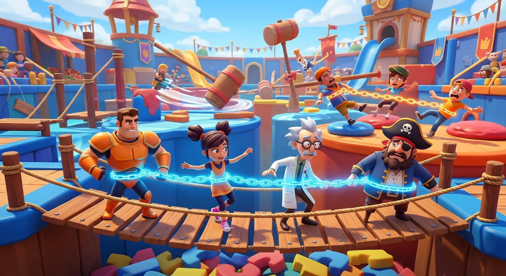

# Don't Break the Chain

## 1. How the game works

**Don't Break the Chain** is a multiplayer obstacle-course game where two teams compete on the same course. Each team has four players connected by a rope or elastic chain, and every player must reach the finish line together.

The chain has a maximum stretch distance. If one player runs too far ahead or falls too far behind, the chain pulls the team back. Players must communicate, coordinate their movements, and collaborate to overcome obstacles without breaking their formation.

### Core rules

- Two teams compete on the same obstacle course.
- Each team has four connected players.
- All four players must reach the finish line for the team to win.
- The chain behaves like an elastic rope rather than a rigid connection.
- Exceeding the chain's maximum stretch distance pulls players back toward one another.
- Team movement, timing, and communication are more important than individual speed.

## 2. Obstacles

Obstacles are the main source of challenge and comedy. Each one tests the team's timing, positioning, and ability to stay connected.

### Spinning Hammers

Players must time their movements together to pass rotating obstacles without being knocked backward. One mistimed player can pull the rest of the team out of position.

### Narrow Bridges

Players must cross one at a time without stretching the chain too far. The team must decide who leads, who waits, and when it is safe for the next player to move.

### Slippery Platforms

Players slide in different directions, making it difficult to keep the group together. Teammates must counter-steer and adjust their movement to prevent the chain from stretching.

### Moving Platforms

The whole team must jump at the correct time to avoid leaving teammates behind. Moving too early or too late can separate the group and cause a chain reaction.

### Swinging Pendulums

One player might get through while another is knocked backward, pulling the entire chain. The team must recover quickly before the chain drags everyone into danger.

## 3. How teams win

The game can support several competitive modes.

### Race Mode

The first team to get all four players across the finish line wins.

### Survival Mode

Teams navigate an increasingly difficult course. Obstacles become harder over time, and the last team still moving together wins.

### Challenge Mode

Both teams complete different objectives on the course. The team with the highest score at the end wins.

Possible challenge objectives include collecting items, reaching checkpoints, completing timed tasks, or using the chain to activate team mechanisms.

## 4. Important gameplay mechanics

Controls should remain extremely simple so that players can focus on communication and coordination.

| Action | Control |
|---|---|
| Move | WASD / Arrow keys |
| Jump | Space |
| Sprint | Shift |
| Team pull | Shared chain physics |

### Shared chain physics

The chain should stretch, pull, swing, and bounce like an elastic rope. A player who moves too far away creates tension in the chain, affecting the entire team. This creates funny and unpredictable situations where players pull one another around, accidentally launch teammates, or recover from a near-disaster together.

## 5. Chain formation variations

These variations can expand the game after the core experience is proven.

### A. One Chain, One Team

All four players are connected in a straight line. The first player leads, and the last player must keep up.

This is the recommended starting version because it is easy to understand, easy to teach, and gives every player a clear position in the team.

### B. The Circle Chain

Four players are connected in a circular formation. Everyone must coordinate direction and movement to navigate obstacles.

This formation creates a different kind of teamwork because there is no single leader. Players must communicate continuously and make decisions as a group.

### C. The Chaos Chain

The chain can stretch, swing, and bounce more dramatically. Players can use momentum to launch teammates across gaps, but poor coordination can send the entire team flying.

This can begin as an advanced mode and later be introduced through power-ups, special obstacles, or high-risk shortcuts.

## 6. Recommended development plan

Start with **One Chain, One Team** as the core format:

1. Build basic four-player movement.
2. Add the shared elastic chain physics.
3. Create a simple obstacle course.
4. Add timing-based obstacles such as spinning hammers and moving platforms.
5. Test the chain distance, pull strength, and recovery behavior.
6. Add Race Mode as the first competitive mode.
7. Introduce Chaos Chain mechanics through power-ups and special obstacles.
8. Expand with Circle Chain, Survival Mode, and Challenge Mode after the core game feels fun.

## 7. Game identity

The heart of **Don't Break the Chain** is cooperative chaos. Players should laugh when a teammate makes a mistake, communicate under pressure, and celebrate when the whole team finally crosses an obstacle together.

The game should reward:

- Clear communication
- Coordinated movement
- Patience and timing
- Helping teammates recover
- Creative use of chain momentum

## 8. Visual concept

This concept image shows the intended tone for the game: colorful obstacle courses, readable team chains, expressive characters, and funny physical-comedy moments. It can be used as a visual reference when presenting the idea to a mentor.

## Tagline

**Stay together. Move together. Don't break the chain.**
